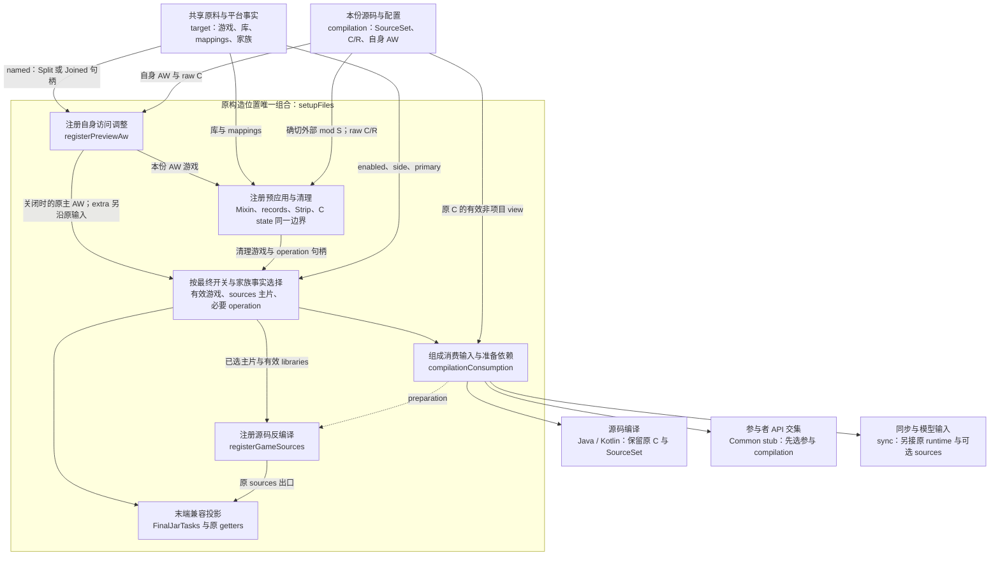
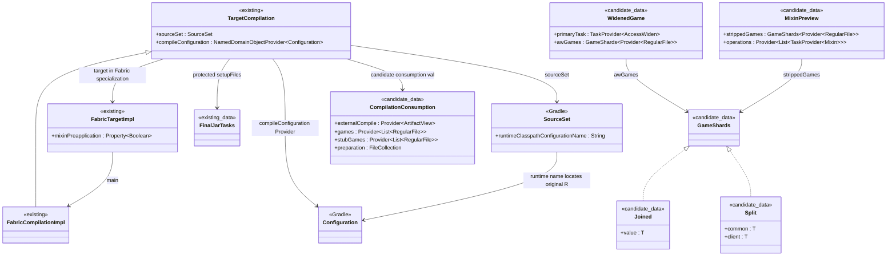
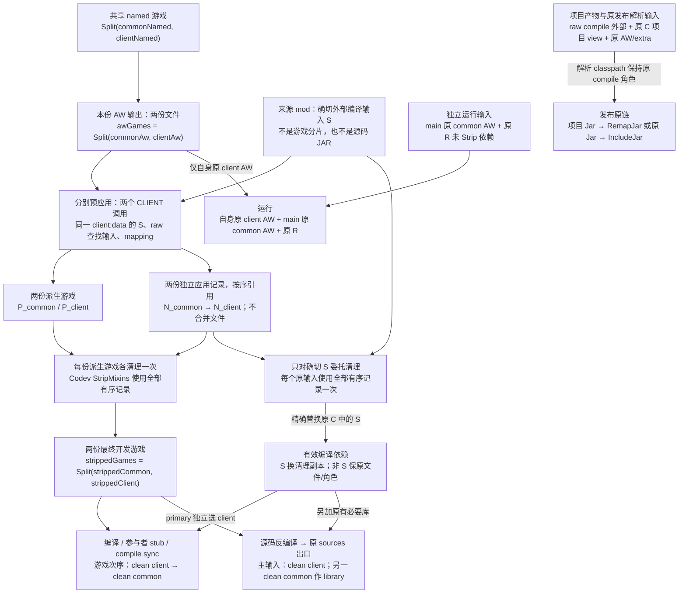
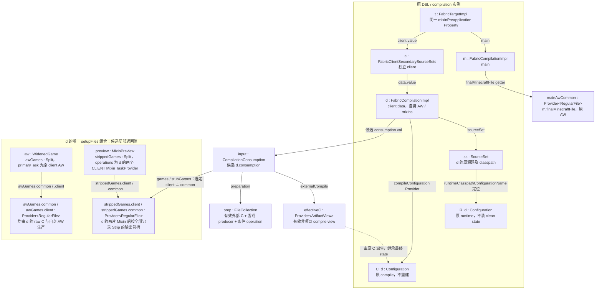
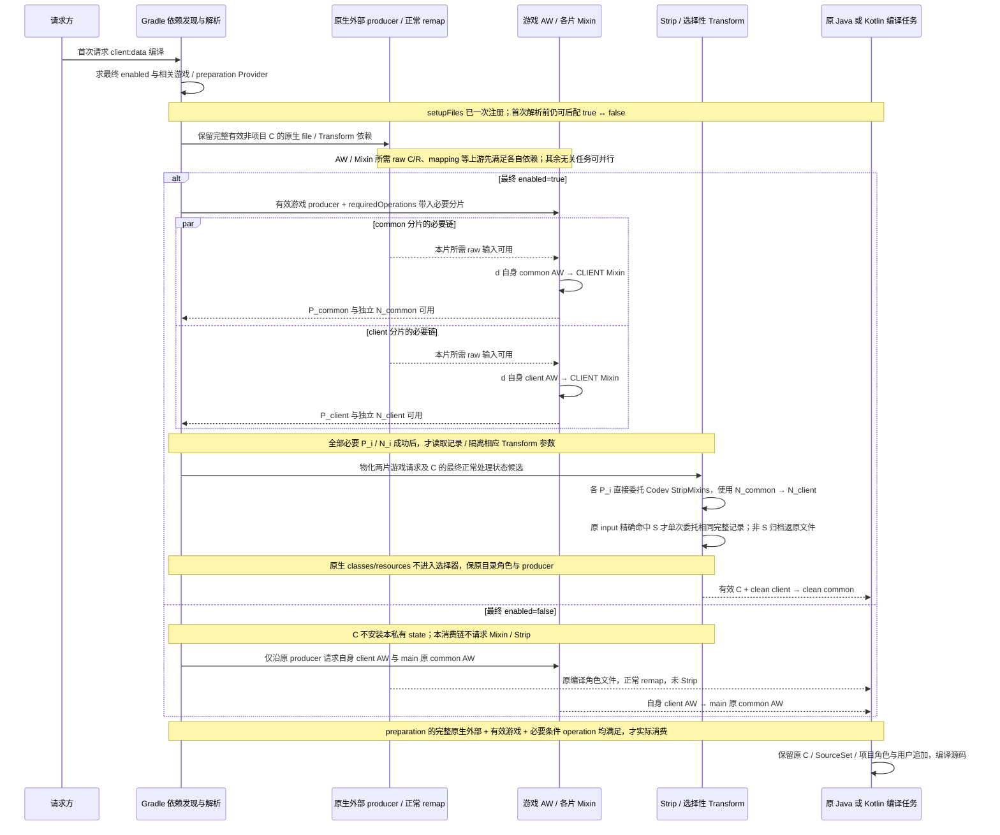
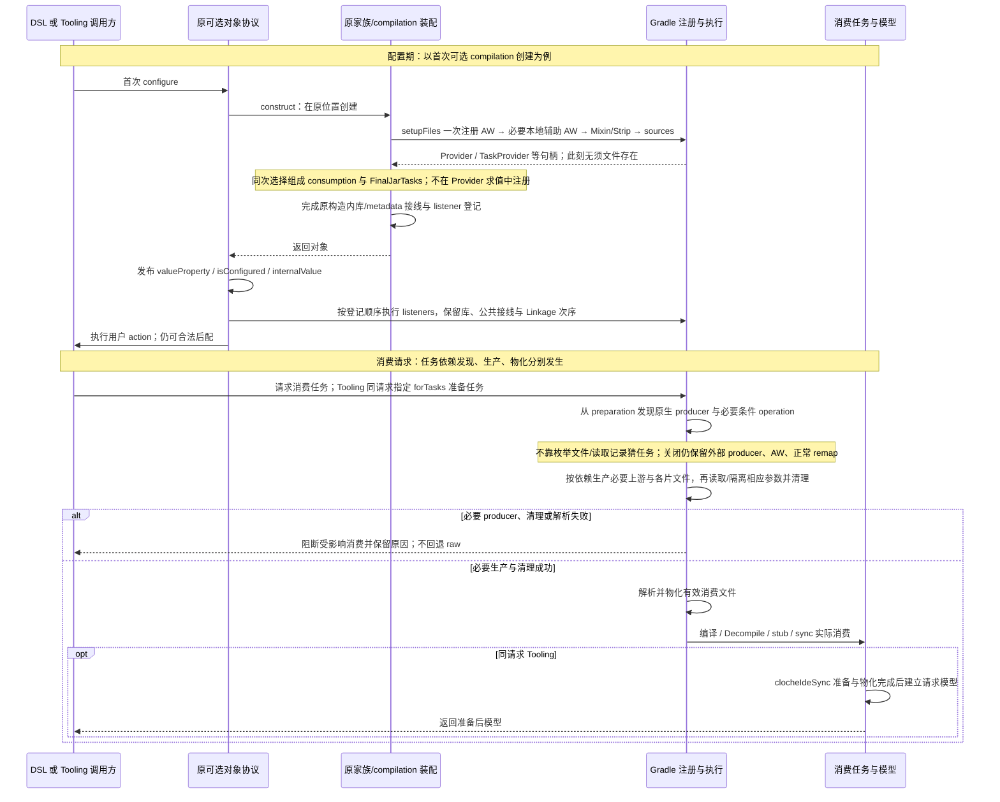
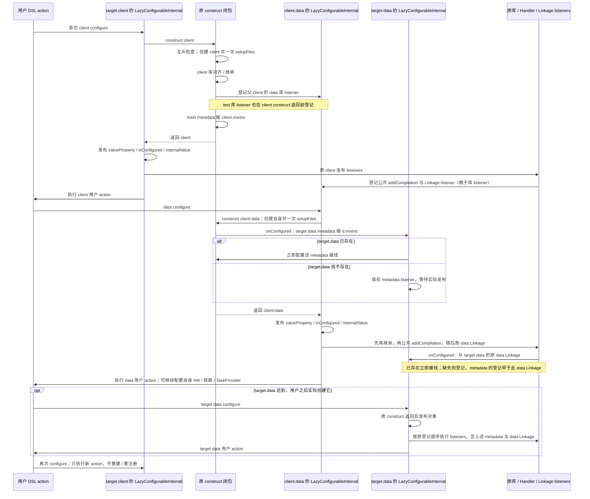
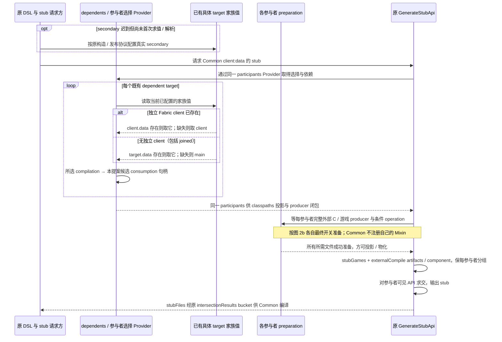
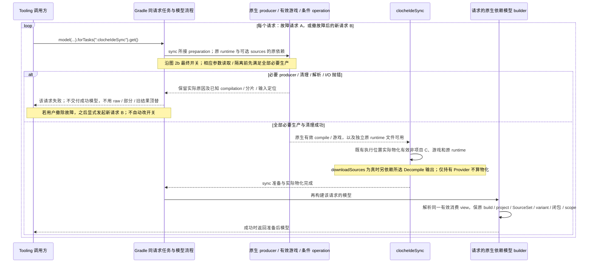

# Target / Compilation 整体架构设计提案

target 提供游戏原料与平台事实，compilation 带上自己的源码、依赖和 AW，得到编译、源码查看与 IDE 使用的开发文件。方案用显式输入的函数连接这些环节，把重复的开关、选片和准备依赖集中起来，状态继续留在原 Gradle 对象中。

**状态：Accepted（整体函数式方案与 Joined/Split 泛型纯数据模型），non-authoritative。** 接受依据为用户在模型展示后表示“可以了，开始生成文档吧”；决定由[函数式组合 ADR](../adr/target-compilation-functional-composition.md) 记录。[全局 Spec](../spec/target-compilation-architecture.md) 已承接模型、阶段投影与兼容合同，[Mixin Spec](../spec/mixin-preapplication.md) 已同步模型及单向适配，统一职责、依赖图与 V3 的具名入口协调也已完成。具体内部标识符、字段名与精确函数签名仍可调整，模型语义不再未决。实际重构尚未开始，生产实施确认尚未取得；接受不构成实施许可或行为验收。

初读可顺着 **[整体关系](#figure-1) → [client:data 构建例子](#client-data) → [首次编译时序](#figure-2b)** 阅读；接口细节集中在第 3.1–3.4 节。

| 想弄清的问题 | 图示 |
| --- | --- |
| 谁存状态，哪些只是返回数据？ | [图 1a：类图](#figure-1a) |
| 两片游戏、记录与外部 mod 怎样流动？ | [图 2：文件流](#figure-2) |
| client:data 引用谁的配置和 AW？ | [图 2a：对象关系](#figure-2a) |
| 注册与执行有什么区别？ | [图 3：总体时序](#figure-3) |
| client/secondary、listeners 与用户 action 怎样排序？ | [图 3a：构造与发布](#figure-3a) |
| Common 怎样选参与者，再准备并求交？ | [图 3b：stub 时序](#figure-3b) |
| Tooling 怎样准备、建模与故障恢复？ | [图 3c：同请求模型](#figure-3c) |

[HTML 说明图](target-compilation-architecture.html) 的节点按本文 §2–§10 的主题导航；§3.0 为边界、§3.1 为供料、§3.2 为 view、§3.3 为组合、§3.4 为消费。当前行为合同以正式 Specs 为准；交付范围与执行图分别见[Plan](../works/target-compilation-functional-decoupling/plan.md) 与 [Waves](../works/target-compilation-functional-decoupling/waves.md)。文档接受与规划就绪不构成生产实施确认、item 执行或 gate 完成。

## 1. 问题、范围与 authority

同一份 client:data 的编译、sources、Common stub 和 sync 都要知道选哪份游戏、先准备哪些文件。若各处独立解释开关、分片和记录，新增消费者便要再学一次协议。目标是让消费者取得已选好的输入与准备依赖，同时保住平台家族、配置身份和构造时点。

范围覆盖平台供料→家族装配→依赖选择→转换组合→开发消费，以及 Common、Linkage、run 和发布。现 [TargetCompilation](../../src/main/kotlin/earth/terrarium/cloche/target/compilation/TargetCompilation.kt) 已有转换函数；本设计还收窄 [FabricTargetImpl](../../src/main/kotlin/earth/terrarium/cloche/target/fabric/FabricTargetImpl.kt)、[TargetHandler](../../src/main/kotlin/earth/terrarium/cloche/target/TargetHandler.kt)、[CommonTargetCreator](../../src/main/kotlin/earth/terrarium/cloche/target/common/CommonTargetCreator.kt) 与 [CompilationInternal](../../src/main/kotlin/earth/terrarium/cloche/target/compilation/CompilationInternal.kt) 间传播的知识。源码链接用于定位既有结构，不作为新设计已实现的证据。

本文 Kotlin 均为设计示意。公开 DSL、原 Gradle 对象和出口的兼容边界集中在[第 9 节](#9-兼容authority-衔接与迁移切口)，未决与验证限制集中在[第 10 节](#10-未决与未来验证义务)。角色精度、Forge clientTest、sources/javadoc 普通布尔时序、Common 环/孤立语义、测试环境迁移及缓存历史问题不在本方案修复范围；不增加引擎能力或公开 DSL。

## 2. 领域边界与状态位置

以 Fabric 为例：**target 选定 Minecraft、loader、mappings，并组织 main、独立 client 及各自 data/test；compilation 是其中一份有自己源码与依赖的构建视图。** client:data 不是另一个 loader，也不是一次任务执行。

| 归属 | 保存什么 |
| --- | --- |
| target | 版本、平台库、metadata conventions、家族、run、最终产物选择，以及全家族共用的 `mixinPreapplication: Property<Boolean>` |
| 每份 compilation | 自己的 SourceSet、依赖 collectors/attributes、原 compile/runtime Configuration、AW/Mixin 声明与输出；不能借另一 compilation 的预应用结果 |
| 原 Gradle 对象 | Property 保存可后配的值，Configuration 保存请求，Task 保存任务配置，SourceSet 保存源码/classpath 关系；函数接这些原句柄 |

AW（Access Widener）先调整游戏类/成员的访问权限。**target 顶层 AW 只是 main AW 的快捷转发，不是全家族默认 AW。** 预应用开发视图（preview）使用当前 compilation 的外部编译依赖与自身 AW；其 `mixins` 是本项目待打包资源，预应用来源则是外部编译 mod。

Fabric 原料是 `common/client` 两份游戏 JAR，允许重复类、资源和 metadata。CLIENT 开发视图分别处理两片，按 client→common 查找，不 Join、不去重或合并成员；SERVER 有效视图只用 common。Forge/NeoForge 原料已是 `joined` 一份，joined 不表示两侧一起应用。

**Common 共享源码**与小写的**游戏 common 分片**不同：Common 对参与 target 可见 API 求交生成编译用 stub，没有自己的游戏 runtime，也不另造 Mixin operation（每片预应用任务）。feature 则是非 test 的 Gradle 输出接线：沿原规则复用真实 Java main 变体，其他合适 SourceSet 才注册 feature；多 target 的 main 未必是 Java main。test 没有 outgoing feature 或归档任务。其余术语沿用[领域 Context](../../CONTEXT.md)。

装配可以使用具体 target 与 `target.main` 配对关系双方；底层机制只接所需值和原句柄。`Project` 提供实际注册能力，小型结果只保存数据，不含服务、回填 Property、注册表、target 回引用或可执行闭包；不另造 context、职责对象或生命周期。

<a id="figure-1"></a>

**图 1：共享输入与每份 compilation 的组合。** 实线传输入/结果句柄，虚线表示消费准备；此处是注册与接线，不是立即执行。



<a id="figure-1a"></a>

**图 1a：状态与返回类型。** existing/Gradle 为现有类型，candidate data 表示内部接口示意、具体命名可变，不表示 Joined/Split 模型尚未接受；关联线仅表示引用，函数仍是顶层函数。



`WidenedGame/MixinPreview` 是 `setupFiles` 局部返回值，`consumption` 才是候选 compilation 成员。图中 target 关系只展开 Fabric 特化；开关是同一个继承的 DSL Property，R 仍按原 SourceSet 名称定位。图只列相关字段，完整候选定义见 §3.3–3.4，旧布局见 §9。

## 3. 主组织：从显式输入到注册、接线与消费

<a id="client-data"></a>

### 跟读一条路径：Fabric 独立 client:data

取 `fabric { client { data() } }`，假设预应用开启，按一次构建的输入顺序跟读：

1. **取得原料与自身配置。** 平台交出开发命名空间下 named common/client 游戏的 Provider（将来取文件的句柄）。client:data 有自己的源码、AW 和编译/运行配置，后文简称 **C/R**。排项目、尚未经本轮 Mixin/Strip 的外部输入叫 **raw**；它仍可能已经正常 remap/include。专供正常 remap 查找的 **unmapped** 还要求 `REMAPPED=false`，细分见 §3.2。
2. **注册自身 AW。** `registerPreviewAw` 接 `Split(commonNamed, clientNamed)`、本份 raw C 与自身 AW，返回 `awGames = Split(commonAw, clientAw)`。`primaryTask` 保原主 AW 任务，本例主片 client。runtime 的 common extra 则引用 **main 的原 AW**，不另注册本地 runtime common，更不拿本份 preview common 替代。
3. **分别预应用并清理。** `selectMixinSources` 从本份 raw compile 图选确切外部 mod **S**：含 compileOnly、既有传递 mod，排除普通库、项目、本项目输出和 runtimeOnly。两个 CLIENT Mixin 各产生游戏 `P_common/P_client` 与独立记录 `N_common/N_client`。每份派生游戏和确切 S 中每个 mod，均单次委托 Codev StripMixins，传入 common→client 的完整有序记录。只删除记录匹配的配置条目，保留类、配置文件、metadata、refmap；Cloche 不合并记录或重写算法。`strippedGames` 表示 AW→Mixin→Strip 后的分片，不代表 vanilla 或全部依赖。
4. **统一选开发出口与准备依赖。** 开启时游戏为 clean client→clean common，sources 主输入为 clean client，另一片作 library，不承诺一个 sources JAR 覆盖两片。`compilationConsumption` 同时组合有效非项目 C、游戏和 `preparation`；它保留“谁生产文件”的 **producer 关系**。Java/Kotlin 编译、sources、Common stub、sync 各在原位置消费，差异见 §3.4、§6。
5. **运行与发布沿原出口。** 本例 run 用自身原 client AW、main 原 common AW 与 R 中正常 remap、未 Strip 的依赖；发布仍是项目 Jar/remap/include，解析输入为 raw compile 外部、原 C 项目 view 与原 AW/extra，见 §5.4。

开关选择通过原 C 上的私有属性 state 接入：它请求“本 compilation 的清理消费视图”，不是新配置对象。下文 clean 均指按记录 Strip 后的结果。

开关关闭时按原规则选“自身 client AW→main 原 common AW”，sources 回到自身 client AW；C 不安装本私有 state（包括 raw），`requiredOperations` 直接为空且不读取本轮 operations。stub 关闭顺序独为 extra→primary；外部 producer、AW 和正常 remap 仍需准备。这是最终开关选择，不是 clean 失败后的回退。

**side 与 primary 分开：** side 决定 Mixin 环境及有效分片，primary 保原主 AW/sources 选片。独立 client 二者碰巧都是 client；未分割、未 includedClient 的 main 却是 CLIENT + primary COMMON。side 由家族事实提供，不能从 primary、distribution 的 common 字样或名称前缀推断。

<a id="figure-2"></a>

**图 2：client:data 的文件流。** 展示开启分支；两片始终独立，记录箭头只表示传入顺序。



图中开发四出口还要等待同一 preparation；运行和发布的线不提供失败回退。必要生产/清理失败的处理统一见 §7。

<a id="figure-2a"></a>

**图 2a：client:data 的对象与句柄。** 用 flowchart 模拟对象关系，并非原生 UML objectDiagram。t/m/c/d 为逻辑实例名，实线为引用，虚线为 view 派生依据；局部返回值单列。



两个 Split 节点各合列两份句柄，没有合并文件。`aw.primaryTask.flatMap(AccessWiden::outputFile)` 投影到本例的 `awGames.client`；`mainAwCommon` 另经 runtimeExtra 进入同组 FinalJarTasks。`input.externalCompile` 是原 C 的有效非项目 view，不替换 C；Provider 存在也不等于文件已生产。

### 3.0 全局耦合审视：保留领域联系，收窄知识传播

| 边界 | 集中的知识 | 保留的联系 |
| --- | --- | --- |
| 平台注册 / 家族装配 | 注册返回原料；装配配对版本、家族、库与 metadata | 原 init/construct 时点、库一致性和 secondary 继承 |
| 依赖 view / buckets | 原配置、角色算法、完整 unmapped 与 collectors 接线 | 不用角色并集重建 C/R，不借机修角色精度 |
| `setupFiles` / 窄机制 | 组合配对输入；AW、preview、sources 分别管理细节 | 一次注册、原先后、同组兼容投影 |
| preview 一致性边界 | Mixin、records、Strip、确切 S 与原 C state | 避免有 state 无记录或跨 compilation 错配 |
| 消费输入 / 各消费者 | 开关、选片与 preparation 只组合一次 | 原 SourceSet/C、原生 producer、实际物化各有义务 |
| Linkage / Common / run | 成组关系与各自选择策略 | Common/run 回退不同，不合成通用 selector |
| SourceSet 目录 / sync / classifier | 各自可独立变化的接线 | 原调用位置与顺序，test 例外 |

目录候选 `connectSourceDirectories(project: Project, sourceSet: SourceSet, directory: Directory): Unit` 只在原非 single-target 分支添加 Java/resources/Kotlin 目录，保留 plugins.withId。classifier 留非 test 局部块：原 Jar 用 devClassifier、include/remap 用 classifier，destinationDirectory 仍连原 Provider；prefix/capability/namespace 属归档装配。原 configureSourceSet wrapper 可保顺序，不为单个 set 导出浅包装。

### 3.1 平台任务注册：返回现有句柄，不返回行为对象

Fabric 结果的真实消费者包括 compilation、remap、run 和库装配：

```kotlin
// 设计示意：内部数据结果，无成员行为。
data class FabricGame(
    val common: Provider<RegularFile>,
    val client: Provider<RegularFile>,
    val intermediary: FileCollection,
    val commonLibraries: Configuration,
    val clientLibraries: Configuration,
    val mappingsArtifact: TaskProvider<Zip>,
    val remapClasspath: TaskProvider<WriteClasspathFile>,
)

fun registerFabricGame(
    project: Project,
    targetName: String, featureName: String?,
    minecraftVersion: Provider<String>,
    minecraftNamespace: Provider<String>,
    outputDirectory: Provider<Directory>,
    mappings: Provider<RegularFile>,
): FabricGame

fun connectMinecraftLibraries(
    libraries: Configuration,
    runtime: Configuration,
    localImplementation: NamedDomainObjectProvider<Configuration>,
) {
    libraries.shouldResolveConsistentlyWith(runtime)
    localImplementation.configure { extendsFrom(libraries) }
}
```

`registerFabricGame` 每 target 在原资源声明点一次创建原库配置、resolve/remap、mappings artifact 与 writeRemapClasspath 任务，保名字、路径和 Provider 分支。库的 enforced platform/capability 依赖仍在原 init 填入，再创建 main、关联 main R；mappings 来自现 loadMappingsTask，registerMappings 的连接留原 init。注册函数不解析 R。

`connectMinecraftLibraries` 只建立原库与 R 的一致性及 localImplementation 继承。secondary 继承相同库，不逐个重新对齐；缺 client/includedClient 时不新增 client 库与 R 的关联。Fabric 的 `preapplicationLibraries = project.files(game.commonLibraries, game.clientLibraries)` 直接复用现供料。

joined 使用对应注册签名：

```kotlin
fun registerJoinedGame(
    project: Project,
    targetName: String, featureName: String?,
    minecraftVersion: Provider<String>,
    loaderVersion: Provider<String>,
    minecraftNamespace: Provider<String>,
    outputDirectory: Provider<Directory>,
    mappings: Provider<RegularFile>,
    neoforge: Boolean,
): JoinedGame
```

`JoinedGame` 仅含 `named: Provider<RegularFile>`、`patched: TaskProvider<ResolvePatchedMinecraft>`、`generateClientExtra: TaskProvider<GenerateForgeClientExtra>`、`clientExtra: FileCollection`、`libraries: Configuration`、`universal: Configuration`。legacy 直接取 generateClientExtra 输出，implementation 的 clientExtra 集合仍按原版本条件选择。`neoforge` 决定既有 client-extra task 与 loaderName（neoforge/forge），不推导 side；userdev/universal 选择留平台 init，patches/mappings 配置建好后才 configure patched task，库对齐 main R。

joined 路径沿原 `ForgeLikeTargetImpl.output` 惰性组合：

`suffix.flatMap { suffix -> outputDirectory.zip(minecraftVersion.zip(loaderVersion) { a, b -> "$a-$b" }) { dir, version -> dir.file("$loaderName-$version-$suffix.jar") } }`

loaderVersion 直接接原 Property/Provider，不提前 get；outputDirectory 只是 `build/minecraft` 下 capabilitySuffix 目录，不含 loader 版本。文件名保持 `$loaderName-$minecraftVersion-$loaderVersion-$suffix.jar`：patched suffix 为 minecraftNamespace，空时 named；client-extra 为 client-extra；named remap 为 named。原 namespace 决定 patched/remap 分支与 producer。

**在原 Info 构造位置传入形状：**

```kotlin
// Fabric main/data/test：named 拓扑不随 includedClient/hasSeparateClient 变化。
val namedGames = GameShards.Split(common = game.common, client = game.client)
val primaryGame = includedClient.map { if (it) GamePart.CLIENT else GamePart.COMMON }
// 独立 client 及其 data/test 复用 named 两片，primaryGame = provider { GamePart.CLIENT }。
// joined Forge/NeoForge：
val joinedGames = GameShards.Joined(gameJoined.named)
val joinedPrimary = project.provider { GamePart.JOINED }
```

Info 候选字段为 `namedGames: GameShards<Provider<RegularFile>>`、`primaryGame: Provider<GamePart>`；secondary 传递原句柄，side 另由家族 Provider 提供。独立 runtime 辅助输入 `runtimeExtraMinecraftFiles` 仍沿原 Map 协议，不混入 named→AW→preview 形状；旧 String/Map 入口的适配集中见 §9。

### 3.2 依赖选择：函数直接接原配置

view 函数不注册任务或修改原配置，但求值会触发 Gradle 解析，并非数学意义的纯函数。

```kotlin
// 沿用现 helper；配置参数不再由任意 target 隐式取得。
fun getNonProjectArtifacts(c: Provider<out Configuration>): Provider<ArtifactView>
fun getRawNonProjectArtifacts(c: Provider<out Configuration>): Provider<ArtifactView>
fun unmappedExternalFiles(project: Project, c: Provider<out Configuration>): FileCollection
fun rawRoleFiles(project: Project, c: Provider<out Configuration>,
    role: Provider<out Configuration>, unmapped: Boolean): FileCollection
fun publicationClasspath(project: Project, c: Provider<out Configuration>): FileCollection

fun connectCompilationBuckets(project: Project, sourceSet: SourceSet,
    collectors: ClocheDependencyHandler, isTest: Boolean): Unit
```

`connectCompilationBuckets` 承接现 addDependencies 的完整操作，在 feature 后原位置每 compilation 一次创建 mod buckets/四个辅助 resolvable 配置并连接继承与 collectors；不新增 CompilationDependencies 对象。view 可重复组合，常用结果存局部 val；早于 buckets 的角色查找必须延迟，求值中不注册/configure task。

| view | 输入与用途 |
| --- | --- |
| `getNonProjectArtifacts(C)` | 完整有效非项目 C，继承最终消费 state；供准备依赖、stub/sync 的 files 与 component 投影 |
| `getRawNonProjectArtifacts(C/R)` | 排项目、显式 raw，保正常 remap、variant/scope；供 AW/Mixin 等上游 |
| `unmappedExternalFiles(project, C/R)` | 各自从原 C/R 直接派生完整 raw + REMAPPED=false；二者加 intermediary 接原 RemapAction.extraClasspath，不由角色并集重建 |
| 同上 R 结果 | 在原非空 mod namespace 条件下给 AW remapHelpers 提供生产依赖，不作为 AW 内容 |
| `rawRoleFiles(C/R, role, unmapped)` | 保现 `(id, variant)` 主/辅助图交集与 builtBy；normal remap 用 unmapped 角色，Mixin S 用正常 remap 后 raw compile 分类 |
| `publicationClasspath(project, C)` | raw 非项目 compile + 原 C 项目 view；归档装配另加原 AW/extra |

unmapped 对应现 getUnmappedClasspath。角色 mod+ordinary 不能证明完整 C/R；classifier/substitution/capability/file 精度未证明，不删辅助图、不缩支持或加 fallback。raw 只覆盖上游非项目 view；原 C/R、项目身份和正常处理属性保持，完整约束见[全局配置/producer 合同](../spec/target-compilation-architecture.md#原配置角色和-producer)。

### 3.3 setupFiles 直接组合：AW、preview、sources 各守自己的知识

`setupFiles` 在 compilation 原构造位置直接组合，不再把全量参数转发给 registerCompilationTransformations 或新 context。Info 在此展开；机制函数不取得整个 Info/target/compilation。组合只知道输入配对和一次注册顺序，不实现角色、records、Transform 或反编译算法。

**GameShards 表示固定拓扑。** `Joined(value)` 是单片，`Split(common, client)` 是两片，不表示是否创建独立 client compilation。named、awGames、strippedGames 均用 `GameShards<Provider<RegularFile>>`；preview 任务用 `GameShards<TaskProvider<Mixin>>`，复用结构与角色映射。SERVER 仍保 Split 静态注册，仅 common 进入有效游戏/operations；单元素有效列表不是 Joined。开关、side、primary 改值不重新注册拓扑。

完整定义与窄函数接口如下；字段名分别说明 AW 后与 Mixin→Strip 后的阶段：

```kotlin
// internal 纯数据的接口示意；模型已接受，具体命名/签名可变；无职责方法、状态管理或 target 回引用。
sealed interface GameShards<out T> {
    data class Joined<T>(val value: T) : GameShards<T>
    data class Split<T>(val common: T, val client: T) : GameShards<T>
}
enum class GamePart { COMMON, CLIENT, JOINED }

data class WidenedGame(
    val primaryTask: TaskProvider<AccessWiden>, // 原主 AW 句柄不变
    val awGames: GameShards<Provider<RegularFile>>,
)
data class MixinPreview(
    val strippedGames: GameShards<Provider<RegularFile>>,
    val operations: Provider<List<TaskProvider<Mixin>>>,
)
fun registerAccessWiden(
    project: Project, taskName: String, input: Provider<RegularFile>,
    directory: Provider<Directory>, namedSource: Provider<Boolean>,
    wideners: FileCollection, remapPreparation: FileCollection,
): TaskProvider<AccessWiden>

fun registerPreviewAw(
    project: Project, taskNameParts: List<String?>, directory: Provider<Directory>,
    named: GameShards<Provider<RegularFile>>, primary: Provider<GamePart>,
    namedSource: Provider<Boolean>, wideners: FileCollection,
    remapPreparation: FileCollection,
): WidenedGame

fun selectMixinSources(project: Project, rawCompile: FileCollection,
    explicitMods: FileCollection, ordinary: FileCollection): FileCollection

fun registerMixinPreview(
    project: Project, taskNameParts: List<String?>, directory: Provider<Directory>,
    operation: Provider<String>, compile: NamedDomainObjectProvider<Configuration>,
    enabled: Provider<Boolean>, side: Provider<String>,
    awGames: GameShards<Provider<RegularFile>>, sources: FileCollection,
    rawCompile: FileCollection, rawRuntime: FileCollection, libraries: FileCollection,
    modNamespace: Provider<String>, mappings: Provider<RegularFile>,
): MixinPreview

fun registerGameSources(
    project: Project, taskName: String, output: Provider<RegularFile>,
    input: Provider<RegularFile>, classpath: FileCollection,
    preparation: FileCollection,
): TaskProvider<Decompile>
```

`taskNameParts` 为原 target/compilation feature 两段 `List<String?>`，只供 lowerCamelCaseGradleName；directory 为原 target.outputDirectory/namePath。operation identity 单独用真实 project/target/compilation 名字构成，不从 collapsed feature 推导。

**AW 的 primary/other 注册。** `registerAccessWiden` 只注册一个原 AW task，接 input、namedSource/namespace、wideners、remapPreparation 与原输出命名，不知道 C/R、开关、side 或 Mixin。`registerPreviewAw` 以同 compilation wideners 保原 primary/other 任务/目录，不能按 common/client 改名。局部 widen(suffix,input) 同步调用单任务函数；null 为原主任务，other 为原 other，注册不放进 Provider：

```kotlin
// registerPreviewAw 内部；primary 是 Provider<GamePart>，尚未读值。
val primaryTask = widen(null, primary.flatMap { selectGame(named, it) })
val primaryFile = primaryTask.flatMap(AccessWiden::outputFile)
val awGames = when (named) {
    is GameShards.Joined -> GameShards.Joined(primaryFile)
    is GameShards.Split -> {
        val otherFile = widen("other", primary.flatMap { part ->
            when (part) {
                GamePart.COMMON -> named.client
                GamePart.CLIENT -> named.common
                GamePart.JOINED -> error("joined primary in common/client games")
            }
        }).flatMap(AccessWiden::outputFile)
        GameShards.Split(
            common = primary.flatMap { if (it == GamePart.COMMON) primaryFile else otherFile },
            client = primary.flatMap { if (it == GamePart.CLIENT) primaryFile else otherFile },
        )
    }
}
return WidenedGame(primaryTask, awGames)
```

primary/other outputFile 沿原输入文件名惰性生成；primary 后配切换时，角色字段随 Provider 改指向而不增任务。`primaryTask` 给旧 runtime/FinalJarTasks，awGames 给 preview/sources。本地 runtime auxiliary 另复用单任务函数，沿旧 common 名称及 `target.outputDirectory/lowerCamelCase(featureName, part)` 目录：preview wideners=本份 raw C+自身 AW，本地 auxiliary wideners=本份 raw C+targetAW。独立 client 家族的 runtime common 则沿 main 原 AW。

**preview 的一致性边界。** selectMixinSources 延续普通库排除、explicit mod 优先与 isMod 检测，返回 `builtBy(rawCompile, explicitMods, ordinary)` 的惰性 FileCollection，不在注册体读取文件。registerMixinPreview 同时拥有 Mixin 注册、记录次序、游戏 Strip、确切 S selector、原 C.withDependencies 中按最终 enabled 安装 state、原 afterEvaluate Transform/mapping 接线；不向外导出任意拼装的 state/records。两片只读 AW 后、Mixin 前的 raw 输入；sources 配置保持高于 raw 游戏同名资源的优先级。

下面顶层/private 函数分别处理保形映射、primary 选择和两种顺序。泛型只复用结构，不能证明 AW/Strip 字节阶段或 primary 匹配；不加 phantom type、阶段 wrapper 或执行器。

```kotlin
// 同步遍历静态角色；transform 立即调用、不存入结果。注册只在配置期这样调用一次。
fun <A, B> mapShards(games: GameShards<A>, transform: (GamePart, A) -> B): GameShards<B> =
    when (games) {
        is GameShards.Joined -> GameShards.Joined(transform(GamePart.JOINED, games.value))
        is GameShards.Split -> GameShards.Split(
            common = transform(GamePart.COMMON, games.common),
            client = transform(GamePart.CLIENT, games.client),
        )
    }
fun <T> selectGame(games: GameShards<T>, part: GamePart): T = when (games) {
    is GameShards.Joined -> { require(part == GamePart.JOINED); games.value }
    is GameShards.Split -> when (part) {
        GamePart.COMMON -> games.common
        GamePart.CLIENT -> games.client
        GamePart.JOINED -> error("joined primary in common/client games")
    }
}
// preview 内定义两种实际协议；side 仅在其 Provider 内取得，不用来决定注册拓扑。
fun <T> previewClasspathOrder(games: GameShards<T>, side: String): List<T> = when (games) {
    is GameShards.Joined -> listOf(games.value)
    is GameShards.Split -> if (side == "SERVER") listOf(games.common)
        else listOf(games.client, games.common)
}
fun <T> previewRecordOrder(games: GameShards<T>, side: String): List<T> = when (games) {
    is GameShards.Joined -> listOf(games.value)
    is GameShards.Split -> if (side == "SERVER") listOf(games.common)
        else listOf(games.common, games.client)
}
```

在 registerMixinPreview 内：

1. `mapShards(awGames) { part, input -> /* 原 tasks.register<Mixin>，inputFile.set(input)，返回 TaskProvider */ }` 得到 mixinTasks；part 仅在任务名、目录和清理 type 处转原 common/client/joined 标签。每任务解析游戏用 `side.map { previewClasspathOrder(awGames, it) }`，并保持外部 sources 配置的先行优先级。
2. `operations = side.map { previewRecordOrder(mixinTasks, it) }`，再 flatMap 到 ListProperty，按序 `add(task.flatMap(Mixin::appliedMixins))` 得完整 records；游戏与确切 S selector 共用它。记录顺序不由 mapShards 遍历偶然决定，不使用 values.reversed()。
3. 再 mapShards(mixinTasks) 注册原独立 detached 游戏请求/afterEvaluate Codev StripMixins，input 为 `task.flatMap(Mixin::outputFile)`，removalsFile.from(records)，得到 strippedGames。SERVER 的 client 静态句柄仍在，但不进入本消费链的 operations/records/有效游戏。

selectGame 遇形状不匹配即失败，沿旧 getValue/唯一 other 的错误传播，不猜主片；工厂保证 Fabric primary 为 COMMON/CLIENT，joined 为 JOINED。side 沿原有效 CLIENT/SERVER Provider，与 GamePart 独立。

registerGameSources 只接已选 input、有效 classpath、preparation 与原 output，注册 Decompile；不重判平台/side/开关，不读 records 或重注册 preview。mapping/context 留 Mixin Task，反编译选项仍经 Decompile TaskProvider.configure 后配。

**完整组合示例：独立 client:data。** rawC/rawR/unmappedC/unmappedR 在紧邻原 setupFiles 前建立为私有惰性 val，并复用到原 remap；C/R 是原配置 Provider。listFiles 表示 ObjectFactory.listProperty 按序 add Provider。Fabric side 由 `hasSeparateClient.map { separate -> if (separate && !clientFamily) "SERVER" else "CLIENT" }` 提供，clientFamily 为固定家族事实；joined 固定 CLIENT。enabled 直接接 target.mixinPreapplication。

explicitCompileRole/ordinaryCompileRole 分别延迟查 `configurations.getByName(resolvableModConfigurationName(C.name))` 与对应 resolvableNonModConfigurationName，等原 buckets 存在后使用。

```kotlin
val rawC = project.files(getRawNonProjectArtifacts(C).map { it.files })
val rawR = project.files(getRawNonProjectArtifacts(R).map { it.files })
val unmappedC = unmappedExternalFiles(project, C)
val unmappedR = unmappedExternalFiles(project, R)
// 以下在原 setupFiles 初始化位置的 init 块执行一次。
val awPreparation = project.files(modNamespace.map { ns ->
    if (ns.isEmpty()) emptyList() else listOf(unmappedR)
}) // 只有生产依赖；绝不作为 AW 内容
val names = listOf(targetFeature, compilationFeature)
val aw = registerPreviewAw(project, names, directory, info.namedGames,
    info.primaryGame, minecraftVersion.map(::isUnobfuscatedVersion),
    project.files(rawC, accessWideners), awPreparation)
val primaryAw = aw.primaryTask.flatMap(AccessWiden::outputFile)
// 独立 client:data 的 info.runtimeExtraMinecraftFiles 为空；extra 指向 main 原 AW。
// 其他入口在同一位置 map 本地 named extras 调 registerAccessWiden（见下文）。
val runtimeExtra = info.extraClasspathFiles
val sources = selectMixinSources(project, rawC,
    rawRoleFiles(project, C, explicitCompileRole, unmapped = false),
    rawRoleFiles(project, C, ordinaryCompileRole, unmapped = false))
val preview = registerMixinPreview(project, names, directory,
    side.map { "${project.path}:$targetName:$compilationName:$it" }, C, enabled, side,
    aw.awGames, sources, rawC, rawR, preapplicationLibraries, modNamespace, mappings)
val games = enabled.flatMap { on ->
    if (on) orderedPreviewGames(project.objects, preview.strippedGames, side)
    else primaryAw.zip(runtimeExtra) { p, extra -> listOf(p) + extra }
}
val sourceInput = enabled.flatMap { on ->
    if (on) info.primaryGame.flatMap { selectGame(preview.strippedGames, it) }
    else primaryAw
}
val stubGames = enabled.flatMap { on ->
    if (on) games else runtimeExtra.zip(primaryAw) { extra, p -> extra + p }
}
val requiredOperations = enabled.flatMap { on ->
    if (on) preview.operations else project.provider { emptyList<TaskProvider<Mixin>>() }
}
val consumption = compilationConsumption(project, C, games, stubGames, requiredOperations)
val sourceLibraries = project.files(C,
    games.zip(sourceInput) { all, input -> all.filter { it != input } },
    enabled.zip(side) { on, s -> if (on && s == "CLIENT") preapplicationLibraries else project.files() })
val decompile = registerGameSources(project,
    lowerCamelCaseGradleName("decompile", targetFeature, compilationFeature, "minecraft"),
    directory.zip(info.primaryGame.flatMap { selectGame(info.namedGames, it) }) { dir, file ->
        dir.file("${file.asFile.nameWithoutExtension}-sources.${file.asFile.extension}")
    }, sourceInput, sourceLibraries, consumption.preparation)
val files = FinalJarTasks(aw.primaryTask, decompile, runtimeExtra, games, preview.operations)
// 原 classpath 追加位置：compile += games；runtime += primaryAw + runtimeExtra。
// 原 remap 注册位置仍消费完整 unmappedC/unmappedR + intermediary，不用 sources 并集。
```

`orderedPreviewGames(ObjectFactory, GameShards<Provider<RegularFile>>, Provider<String>): Provider<List<RegularFile>>` 内部仅 `side.flatMap { listFiles(objects, previewClasspathOrder(games, it)) }`。`listFiles(objects, List<Provider<RegularFile>>)` 逐项 add 到原 ListProperty，保 producer、不取 get；形状只在消费边界投影为有序列表。requiredOperations 的关闭分支不求 preview.operations；FinalJarTasks.preapplyMixinsTasks 仍保原完整 Provider。

其余入口复用同一组合，仅供料不同：

- 本地 runtime named extras 在 preview AW 后、Mixin 前 map 注册原 common AW，传 `project.files(rawC, targetAw)` 与同一 awPreparation。`runtimeExtra = distribution.flatMap { if (it == client) listFiles(localExtras).zip(externalExtra) { a,b -> a+b } else externalExtra }`；未 includedClient main 即使 preview CLIENT 也不加入该 extra。
- 分割 main/data/test 保 Split 注册，最终 side=SERVER、primary=COMMON，仅请求有效 common；joined 则为 Joined、primary=JOINED、side=CLIENT，extras 为空，preapplicationLibraries 沿现空 FileCollection。空 mod namespace 仅使 awPreparation 空、不装 mapping tuple，不跳过 preview/Strip/sources。
- 开关在首次解析前支持 true↔false 后配。选择函数可重复求值；所有 register 仍在原构造点恰好一次，顺序为 preview AW→必要本地 auxiliary AW→Mixin/Strip→Decompile，normal RemapAction afterEvaluate 及 attributes/SourceSet 原 init 顺序不动。

原类保留 `protected val setupFiles: FinalJarTasks`，新增候选 `internal val consumption: CompilationConsumption`；在原初始化位置同一 init 块把局部 files/consumption 分别赋给二者，不回填 Info、nullable Property 或闭包。Decompile 新接完整有效外部 C preparation 是接线差异，其首产/Transform 时机仍需动态验证。

### 3.4 消费数据与少量接线函数

消费者取得已选择的外部 view、有序游戏和准备依赖，不再解释 enabled、side、records 或枚举 Mixin：

```kotlin
// 内部数据；整体供多个消费者使用，不实现 Buildable、不存函数。
data class CompilationConsumption(
    val externalCompile: Provider<ArtifactView>,
    val games: Provider<List<RegularFile>>,
    val stubGames: Provider<List<RegularFile>>,
    val preparation: FileCollection,
)
fun compilationConsumption(project: Project, compile: Provider<out Configuration>,
    games: Provider<List<RegularFile>>, stubGames: Provider<List<RegularFile>>,
    requiredOperations: Provider<List<TaskProvider<Mixin>>>): CompilationConsumption

fun connectCompilationTask(task: TaskProvider<out Task>,
    preparation: FileCollection): Unit
fun connectCommonStub(project: Project, task: TaskProvider<GenerateStubApi>,
    participants: Provider<List<CompilationConsumption>>): Unit
fun connectCompilationSync(project: Project, task: TaskProvider<out Task>,
    input: CompilationConsumption, runtimeFiles: FileCollection,
    sources: Provider<RegularFile>, downloadSources: Provider<Boolean>): Unit
```

compilationConsumption 在 setupFiles 游戏选择后组成一次，不注册任务/configuration、不解析文件或修改开关。externalCompile 来自完整有效非项目 C；games/stubGames 接现成 Provider，后者关闭时保原 convertClasspath 的 extra→primary，与 SourceSet 的 primary→extra 不同。

**preparation 的主合同：** `project.files(externalCompile.map { it.files }, games)` 保留原生 TaskDependency，再 `builtBy(requiredOperations)` 补必要条件 operation。因此它同时覆盖 **完整有效非项目 C 的 file/Transform producer + 有效游戏 producer + 必要条件 operation**；关闭仍保外部 producer、AW、正常 remap/include。不能只靠游戏间接带入 Mixin 而省外部依赖，也不能从 stubGames.get、resolvedArtifacts.get、文件枚举或记录内容反猜任务，更不能把依赖回接 raw producer。

句柄投影、生产依赖和真正读取文件是三个义务。connect 函数只在原位置配置已有 task，不新建汇总任务，也不保证重复调用无副作用：

- connectCompilationTask 只 `task.configure { dependsOn(preparation) }`，可直接原位写，不为单行引入独立 Module；不替换编译器 classpath。
- connectCommonStub 共用一个 participants Provider 分别接 classpaths 与各参与者 preparation：

```kotlin
// connectCommonStub 内部示意；不是在 Provider 求值中 configure task。
task.configure {
    classpaths.set(participants.flatMap { inputs ->
        // 组成 ListProperty<List<ResolvedArtifact>>；每项由对应
        // stubGames + externalCompile.artifacts.resolvedArtifacts 惰性投影。
        stubClasspaths(project.objects, inputs)
    })
    dependsOn(project.files(participants.map { list -> list.map { it.preparation } }))
}
```

`stubClasspaths(ObjectFactory, List<CompilationConsumption>): Provider<List<List<GenerateStubApi.ResolvedArtifact>>>` 是私有投影，保每参与者分组、外部 artifacts 的 component，不伪造游戏 component；实际投影/物化在准备完成后进行。

- connectCompilationSync 把 input.externalCompile 原生 files、input.games、原 `runtimeFiles = project.files(primaryAw, runtimeExtra, getNonProjectArtifacts(R).map { it.files })` 接 task inputs，并接 preparation；在既有 sync 执行位置实际读取，downloadSources 为真时再依赖 sources Provider。sources 自身由 registerGameSources 接同一 preparation。

原 classpath 追加点仍调用候选 `connectMinecraftClasspaths(project: Project, sourceSet: SourceSet, compileGames: Provider<List<RegularFile>>, runtimeGames: FileCollection): Unit`：保原 C 与用户追加，compile 追加有效游戏，runtime 追加原 AW/extra，沿原 IDE 兼容的游戏文件配置包装。此处可创建原有 detached 游戏包装，但不重建 C/R；它与编译任务接线各守原位置。

<a id="figure-2b"></a>

**图 2b：首次请求 client:data 编译。** 泳道代表既有 Task/Transform 职责，不是新增对象；箭头规定必要依赖，两个分片可独立生产。



common→client 是清理记录次序，不是两片任务调度次序。图中游戏直接 Strip 与依赖选择性 Transform 可按各自依赖调度；只要求各处理的上游已满足，最终消费等全 preparation。失败统一见 §7；sources、stub、sync 的入口各见 §6，不能由单次编译推定全部通过。

## 4. Fabric 家族的具体装配与时序

[LazyConfigurableInternal](../../src/main/kotlin/earth/terrarium/cloche/target/LazyConfigurableInternal.kt) 保持 **construct 返回→发布 valueProperty/isConfigured/internalValue→按登记顺序执行 listeners→用户 action**。onConfigured 对已有对象立即执行，迟到对象在发布时执行；重复 configure 只跑新 action。这不是“用户配置结束”事件。

<a id="figure-3"></a>

**图 3：注册与执行的总体时序。** 上半部交句柄，下半部才生产、物化和消费；main 仍沿原容器入口。



构造内副作用不能移到发布后 listener，即使最终值相同也不等价；下图展开独立 client/secondary 的原时点。

<a id="figure-3a"></a>

**图 3a：client 与 client:data 的构造、发布和后配置。** construct 闭包/listeners 为原代码位置；省略 test 对称路径，target.data metadata listener 与父 client 库 listener 分开。



迟到分支只登记关系，不自动创建 target.data。client/data 发布不冻结 Property，用户仍可在首次消费解析前合法后配。

原 target init 与 client construct 的接线示意如下：

```kotlin
// game 已在原资源声明点注册；库依赖在原 init 点填入。
main = createFabricMain(/* 现 Info：game 输入，main 家族 */)
// 保留原 mappingsArtifact runtimeOnly 添加位置。
connectMinecraftLibraries(game.commonLibraries, mainRuntime, mainLocalImplementation)
data.onConfigured { c -> inheritMinecraftLibraries(project, c.sourceSet, game.commonLibraries) }
test.onConfigured { c -> inheritMinecraftLibraries(project, c.sourceSet, game.commonLibraries) }
// 原 mappings.fabricIntermediary/registerMappings/metadata rule/loader api 顺序保持。

// 原 client construct 闭包内：
checkClientAllowed() // 原 includedClient 互斥检查及原异常
val c = createFabricClient(/* game 两片；自身 AW；runtime extra = main 原 AW */)
connectMinecraftLibraries(game.clientLibraries, runtimeOf(c), localImplementationOf(c))
c.data.onConfigured { inheritMinecraftLibraries(project, it.sourceSet, game.clientLibraries) }
c.test.onConfigured { inheritMinecraftLibraries(project, it.sourceSet, game.clientLibraries) }
main.generateMetadataTask.configure { clientMixinConfigs.from(c.mixins) }
return c // 完成上述连接/登记后才交给 LazyConfigurable 发布
```

createFabricMain/createFabricClient 只是现 objects.newInstance 位置的简写，runtimeOf/localImplementationOf 只是配置查找简写，不新增公共工厂。可复用的 `inheritMinecraftLibraries(project: Project, sourceSet: SourceSet, libraries: Configuration): Unit` 只 configure 原 localImplementation.extendsFrom，不创建配置或重做一致性。

几个容易被提取函数改变的时点集中保留在此：

- includedClient construct：互斥检查→client 库对齐 main R→main 继承→target data/test 库 listeners→创建并返回；已有 secondary 立即接线。
- [Fabric client secondary](../../src/main/kotlin/earth/terrarium/cloche/target/fabric/FabricClientSecondarySourceSets.kt) 在 data/test construct 返回前登记 target 对应 secondary 的 metadata listener；父 client 的库 listener 早于 Handler 公共接线/Linkage listener。
- 原 addCompilation 保完整顺序：非 test feature→SourceSet（含 sync）→buckets→适用 metadata/copyMixins/AW merge/Jar inject→Java/Kotlin→outgoing/attributes；同一 listener 随后做 Linkage/data 资源连接。main 沿原 single/multi-target 容器路径，Common 源码关系仍由 TargetApplicator 在 addTarget/handleTarget 后登记。
- construct、注册或 listener 失败可能留下部分 Gradle 注册，发布后抛错可能留下已发布对象；不承诺回滚、自动重试或新增 once registry。

## 5. 入口到结果：平台、关系、run 与发布

### 5.1 独立 Fabric client + secondary

原 DSL `fabric { data(); test(); client { data(); test() }; runs { clientData(); clientTest() } }` 沿 §4 构造/发布。家族差异如下，不能只用 side 推导 primary 或 runtime：

| compilation | 静态形状 / 有效 preview | sources primary | 原 runtime 游戏 |
| --- | --- | --- | --- |
| 分割 main 及 data/test | Split 保两片注册；SERVER 只请求自身 common | COMMON | 原 primary AW，extra 沿旧 distribution |
| 独立 client 及 data/test | Split；CLIENT 请求自身两片 | CLIENT | 自身 client AW + main 原 AW common |
| includedClient main 及 data/test | Split；CLIENT 请求自身两片 | CLIENT | 原 client primary + 本地辅助 common AW |
| 未分割且未 includedClient main 及 data/test | Split；CLIENT 请求自身两片 | COMMON | 原 common primary，不新增 runtime common |

本地 runtime auxiliary 显式 AW 来源为 targetAW；独立 client:data 自身 preview common 与 runtime main common 的区别见 §3 示例。clientData 的公共 addCompilation 后仍依次 addDataClasspathDependency(client)、addDataClasspathDependency(main)，再向 target.data 登记迟到关系。每份 compilation 独立 C、operation、记录与 sources，不共享 main clean。

### 5.2 joined Forge / NeoForge

原 `neoforge { data(); test(); runs { client(); server(); data(); test() } }` 不变。各 compilation 将共享 named joined、自身 C/AW、固定 CLIENT 交给同一 setupFiles；没有独立 client compilation，不为 server run 新建 SERVER preview。

[ForgeLikeTargetImpl](../../src/main/kotlin/earth/terrarium/cloche/target/forge/ForgeLikeTargetImpl.kt) 保库/universal、metadata convention、库对齐 main R/继承、secondary 库 listeners、main client-extra、userdev patches/mappings、registerMappings 的原 init 顺序；data/test client-extra implementation 仍在自身 construct 返回前添加。

[ForgeCompilationImpl](../../src/main/kotlin/earth/terrarium/cloche/target/forge/ForgeCompilationImpl.kt) 的 legacy 可抽 `connectForgeLegacyClasspath(task: TaskProvider<WriteClasspathFile>, legacy: Configuration, clientExtra: Provider<RegularFile>, originalGame: FileCollection): Unit`，仅 classpath.from 三项：legacy 保 collectors/attributes、对齐自身 R 并继承平台库；clientExtra 为 generateClientExtra 原输出；originalGame 在 Lex Forge 为原 AW、NeoForge 为空。Lex Forge name-mapping/MCP→SRG/manifest 与 NeoForge 平台属性/AT 留各自机制；空 mod namespace 不跳过 AW/Mixin/Strip/Decompile。

### 5.3 Common、feature 与 Linkage 的装配位置

[Linkage](../../src/main/kotlin/earth/terrarium/cloche/Linkage.kt) 已是直接操作 Gradle 句柄的成组关系，不再包装服务：

| 关系 | 保留内容 |
| --- | --- |
| feature | 原 addCompilation 首项 createCompilationVariants；capability/attributes、classes/resources、sources/javadoc、publication 保原选择，test 例外见 §2 |
| Common 共享源码 | 原 TargetApplicator 的 addSourceDependency：static linkage、common buckets、AW/Mixin、Expect/Actual、class-extension、includedClient weakTreeLink；与 stub classpath 分开 |
| 普通 classpath | 原家族 listener 的 addClasspathDependency：项目 dependency/capability、outgoing、include/constraints 成组保持 |
| dependency 为 test | 原 SourceSet.output 追加到 compile/runtime，不伪造 outgoing feature |
| data | addDataClasspathDependency 保 WITHOUT_DATA 请求、原资源变体与迟到 listener，避免 datagen 回环 |

client:test 仍接 client/main 与对应 target.test；metadata、AW merge/AT/Jar inject 保平台位置。开发 preview AW 不替代发布合并 AW。

### 5.4 Run 与最终产物

[FabricRunConfigurations](../../src/main/kotlin/earth/terrarium/cloche/target/fabric/FabricRunConfigurations.kt) 保原 lazy run DSL：server→main，client→独立 client.orElse(main)，clientData/clientTest→独立 client secondary.orElse(target secondary)。这与 Common 的“独立 client 存在而缺 secondary 则取该 client”不同，不能统一 selector。

run 创建后仍用现 [withCompilation](../../src/main/kotlin/earth/terrarium/cloche/api/run/RunConfigurations.kt) 接所选 SourceSet/runtimeClasspath、modOutputs、withMixinAgent 和平台 assets/natives/remapClasspath 或 patches/legacy；缺必要 secondary 沿原 afterEvaluate 报错，不自动创建。Forge 沿 main/data/test 及 clientTest 原 TODO。[ModOutputGetter](../../src/main/kotlin/earth/terrarium/cloche/target/ModOutputGetter.kt) 按 runtime 项目/Mod ID 分组，其专用 reselection 不能换成 compile 角色查询。

项目产物继续 **Jar→按 namespace 选择 RemapJar/原 Jar→IncludeJar**，保 include bucket、includeTargets listener、collectors/attributes、非传递解析、身份与 manifest。RemapJar 显式 `classpath.from(publicationClasspath(project, C), setupFiles.libraryArtifact, setupFiles.runtimeExtraFiles)`；不接 clean SourceSet 或 R。Fabric 原 Jar inject main 到独立 client，target.finalJar 仍选 client include 或 main include；Forge 仍 main include。游戏不是 outgoing mod JAR；发布若依赖必要编译，仍可能随编译失败。归档代码可留原位，不强提总包函数。

## 6. Common 与 sync 的具体消费

### 6.1 参与者选择与 stub

平台选择函数读取当前已配置家族，不注册源码类型。候选 `selectFabricCommonParticipant(target: FabricTargetImpl, client: Boolean, secondary: String?): TargetCompilation<*>` 与 joined 对应函数只在装配处分派一次，secondary 限现 data/test；原 dependents Provider 求值时选择，不提前拍快照。

| Common 入口 | 对每个已有 dependent target 的选择 |
| --- | --- |
| main | 具体 main |
| main data/test | target secondary，缺则 main |
| client | 独立 Fabric client，否则原有效 CLIENT main |
| client data/test，有独立 client | 该 client secondary，缺则该 client |
| client data/test，无独立 client | target secondary，缺则 main |

<a id="figure-3b"></a>

**图 3b：Common client:data 从参与者到 stub。** 原 participants Provider 在首次求值前可看到迟到对象，不承诺热替换已解析图。



原 intersection 注册位置只投影所选 compilation 的 consumption：

```kotlin
// 在 createCommonTarget 原 intersection 注册位置。
val participants: Provider<List<CompilationConsumption>> = selectedCompilations.map { cs ->
    cs.map { it.consumption } // 已在各自 setupFiles 组合时组成；不在这里注册或 configure
}
val stub = tasks.register<GenerateStubApi>(originalName) { /* 原命名/输出配置 */ }
connectCommonStub(project, stub, participants)
val stubFiles = project.fileTree(stub.flatMap(GenerateStubApi::outputDirectory)).builtBy(stub)
// stubFiles 仍接原 intersectionResults bucket；Common 无游戏 runtime。
```

同一 participants Provider 同时供分组 classpaths 与 producer 闭包，stubFiles 仍接 intersectionResults bucket。参与者可分别开/关，关闭者沿 stubGames 的旧顺序与原生产依赖；Common 不创建 Mixin 或 runtime。若 Fabric client 与 NeoForge main 都注入 X、仅 Fabric 注入 Y，交集只留 X，是未来验证场景，非本次测试结果。

### 6.2 Java/Kotlin、sources、sync、Tooling

```kotlin
// 原 Handler 的 Java/Kotlin 注册位置；SourceSet 游戏追加已在构造内完成。
connectCompilationTask(tasks.named(c.sourceSet.compileJavaTaskName), c.consumption.preparation)
plugins.withId("org.jetbrains.kotlin.jvm") {
    connectCompilationTask(tasks.named(c.sourceSet.getCompileTaskName("kotlin")), c.consumption.preparation)
}
// 原 configureSourceSet 的 sync 位置：
connectCompilationSync(project, tasks.named("clocheIdeSync"), c.consumption,
    originalRuntimeFiles, c.sources, downloadSources)
```

plugins.withId、configureEach/task.configure、用户追加 classpath 与原项目输出保持。originalRuntimeFiles 由原 R 非项目 view+原 AW/extra 惰性组成；sources 的原 Decompile output 与准备在 setupFiles 连接，不要求 sync 访问 FinalJarTasks。

sync 按 §3.4 实际物化有效 compile、游戏和独立原 runtime；TaskDependency、Provider 输入与真正读取文件分别接通。直接 Tooling 沿已有 [R4Tooling.java](../../integration-test/mixin-compilation/R4Tooling.java) 的同请求形式：

```java
connection.model(Observation.class).forTasks(":clocheIdeSync").get();
```

多项目用完整任务路径，保实际 helper arguments/环境绑定。裸 model(...).get 不会自动执行准备；不在 builder 内调度任务或配置期读取文件。

<a id="figure-3c"></a>

**图 3c：同请求 Tooling 的准备、建模与恢复。** A 为故障请求，B 为撤故障后显式新请求；不是同请求内自动重试。此图描述所需合同。



sync 物化或模型解析自身抛错也使请求失败。新请求仅可按合法缓存/workspace 条件复用当前完整有效结果，旧路径存在不等于成功。[TargetsModelBuilder](../../src/main/kotlin/earth/terrarium/cloche/model/TargetsModelBuilder.kt) 结构模型不等于 IDE 编译依赖模型：必须保原 build/project/SourceSet、variant、闭包、scope 与有效文件，允许原生排序/分组，不以文件集相等代替身份证明；不承诺任意第三方物化入口自动支持。

## 7. 失败、惰性与稳定合同

以下是组合必须保持的约束摘要，精确细则仍由 [Mixin Spec](../spec/mixin-preapplication.md) 拥有：

- **失败归属。** AW/Mixin/Strip/Decompile 和原解析报告自身失败；接线让受影响的四消费者等待并观察。必要 producer、记录读取、清理、解析或 I/O 抛错均阻断消费，保原原因及已知 compilation/分片/输入定位；不自动改开关，不取 raw、裸 P、部分/旧文件或空集合顶替。Codev 正常可选失败/fallback 不按日志升级或吞错。构造/监听部分效果见 §4。
- **无环与身份。** raw 仅供上游，clean 仅供开发消费者及 Decompile library，不回流 AW/Mixin/remap；原 C/R/SourceSet 与项目角色不重建，不强造 JAR、不用 withVariantReselection。原生 classes/resources 不进选择器，NO-SOURCE 不造空目录。完整 unmapped、runtime 与发布角色见 §3.2、§5.4。
- **记录与安全清理。** 游戏直接委托 Codev；外部 mod 薄选择器只按原 InputArtifact 完整位置精确判 S 一次，非 S 归档返原文件。保每份记录完整内容/顺序，按 Codev File 首次出现去重，不按 basename/内容合并不同路径；合法空记录仍产副本，零记录失败。Codev 拥有暂存/完成/发布生命周期，后步、close、move、清理错误不得留下可消费的部分/旧结果；原游戏、依赖、记录、mapping、项目产物受保护，不新增 JSON 算法、ledger 或汇总任务。
- **mapping/context 与后配。** mappingFile/sourceNamespace/targetNamespace 按实际 namespace 三项成组，空 namespace 不设，清除也一起清除；默认不设 refmapContext，不从 loader/namespace 猜。沿原 Task 配置并跟踪自定义有效输入，实际 refmap selector 链须真实 fixture 证明，不保证任意混合 namespace/context。enabled/side/primary 在合法首次解析前读同一 Provider，不在 doLast 改解析状态或新增 freeze。
- **缓存与范围。** 选择器按 ABSOLUTE 跟踪输入/S 的内容、成员和位置，不用本地/远程 build cache；相同绝对位置、有效输入/实现及完整 workspace 尚存时可条件复用，不称 FROM-CACHE。游戏直接 Strip 沿 Codev 原 artifact PathSensitivity.NONE 与记录 @Classpath 内容/顺序跟踪，producer 原缓存能力不变。共同 S/记录变化可使非 S 节点重进 action，但不执行 Strip 写出。保证限常规 JAR 原生属性链，不推广混合后缀/冲突状态目录，不新增扫描、报错或通用支持。

细则分别见 [mapping/refmap/context](../spec/mixin-preapplication.md#mappingrefmap-与-context)、[Task/Transform](../spec/mixin-preapplication.md#tasktransform-与无环依赖) 和[失败、空输入与缓存](../spec/mixin-preapplication.md#失败空输入与缓存)。

## 8. 组织方向、维护成本与反例

| 取舍 | 当前理由与代价 | 重访条件 |
| --- | --- | --- |
| setupFiles 直接组合，而非薄全量转换入口 | 当前完整组合只有此一处；避免再转发全部参数，sources 改动不穿透 AW/preview。代价是组合处必须明确连全步骤，编译器不能证明恰好一次 | 出现多个真实完整组合位置 |
| 显式函数与原 Gradle 状态，不加职责对象/TargetContext/模式 pipeline | 保函数式偏好与局部输入权限；共享 Property、家族、Linkage 真实联系仍在，Common/run 策略仍不同 | 实际边界与兼容、时序或首产证据冲突 |
| `GameShards<T>`，而非仅文件的非泛型 JoinedFile/SplitFiles | named/AW/Strip 文件与 Mixin TaskProvider 确有同形投影；共用 mapShards 避免任务→output/records 配对重复。代价是 T 只说明句柄槽位，不提供字节阶段安全 | task 角色不再需要同形投影，或阶段/合法拓扑真实分化 |

非泛型文件形状同样可行，也需保原时序、producer、primary/other 与兼容；当前泛型复用有具体调用依据。字符串 Map 允许空/缺键/混 joined 并外泄插序协议；enumMap、List<Pair>、Pair 序号仍保索引，nullable 字段允许非法组合。逐阶段 wrapper/phantom type 则重复拓扑，当前不增加。完全正交 environment×source×feature 模型没有现多对多需求依据；只沿用旧函数边界也不能集中消费规则。

四个反例限定当前形状与选择：未分割 main 为 Split+CLIENT+primary COMMON；分割 main 为 Split 注册+SERVER 单片有效列表；独立 client:data preview common 用自身 AW、runtime common 用 main 原 AW；joined 不伪造双片。它们不是新增变体或另一套模式调度。

维护成本仍包括 setupFiles 显式配对、Gradle 共享可变状态、Mixin/records/state、变体、Common 回退和 datagen 回环。新增源码类型仍要明确 feature/test、父关系与各自回退；函数化本身不证明性能或 configuration cache 改善。

## 9. 兼容、authority 衔接与迁移切口

约束来源与接受状态已在开篇集中说明。[ADR](../adr/target-compilation-functional-composition.md) 记录方案及模型选择；固定拓扑与阶段投影见[全局 Spec 第 2 节](../spec/target-compilation-architecture.md#固定游戏拓扑与句柄阶段)，唯一原位组合见其[第 5 节](../spec/target-compilation-architecture.md#5-setupfiles-的唯一原位组合)，兼容合同见其[第 8 节](../spec/target-compilation-architecture.md#8-兼容出口运行发布及失败归属)。S/C/R、分片/记录、state、四消费者精确文件与失败/缓存由 [Mixin Spec](../spec/mixin-preapplication.md#compilation-统一转换职责) 拥有。[Mixin PRD](../prd/mixin-preapplication.md) 复用既定产品范围，无产品行为变化；发布/Codev authority 沿原 owner。本文保留解释和接口示意，不另立合同；当前约束与交付导航分别以上述 authority 与 Plan/Waves 为入口。

| 兼容对象 | 必须保留的布局或能力 |
| --- | --- |
| 公开 DSL / main 转发 | 原 MinecraftTarget 经 CommonSecondarySourceSets : Compilation 的公开继承与快捷入口；顶层 AW 仍 main 转发 |
| 原配置与输出身份 | 原 C/R、SourceSet、buckets、feature、项目关系的实例/名称、scope、attributes、capability、variant/classifier、classes/resources、producer、用户追加 classpath；原任务/目录/输出与一次注册 |
| FinalJarTasks | 原包/类身份及 data class 生成接口；字段依次为 `accessWidenTask: TaskProvider<AccessWiden>`、`decompileTask: TaskProvider<Decompile>`、`runtimeExtraFiles: Provider<List<RegularFile>>`、`compileMinecraftFiles: Provider<List<RegularFile>>`、`preapplyMixinsTasks: Provider<List<TaskProvider<Mixin>>>`；保 libraryArtifact/sourcesArtifact |
| setupFiles / getters | protected setupFiles 原类型；finalMinecraftFile、sources、compile/runtime/operation getters 投影同组结果，新消费输入共用唯一生产链 |
| 可见 String/Map 入口 | 如需保原 JVM owner/descriptor，只在兼容入口单向适配同组结果，不复注册或维持第二套逻辑 |

原 `primaryMinecraftPart: Provider<String>` 不能凭泛型擦除就直接改值协议：入口用 map 精确转换 common/client/joined，未知值求值时失败。必要 named Map 入口先校验完整键集合恰为 joined 或 common+client，再构造 GameShards；反向 getter 只把既有形状/枚举投影原标签。新链不逐阶段往返转换、排序或注册。internal Kotlin 也可能有外部 JVM 调用者，保布局并不证明完整 ABI。

旧操作的去向已与接口放在一起：资源字段→§3.1 注册结果；addDependencies/raw helpers→§3.2；AW/preview/sources→§3.3；dependOnPreapplication/convertClasspath/sync 重复规则→§3.4/§6；家族副作用与 listeners→§4。此映射用于核对设计，不是实施步骤或执行图。

## 10. 未决与未来验证义务

已接受模型的既有静态评审未发现必修 finding；它不证明运行行为。主要未决与证据边界集中如下：

1. **具体内部接口收敛。** 函数名、字段名、精确参数/签名仍可调整；Joined/Split 泛型有限形状及跨阶段/任务投影已接受，不再作为整体未选方案。图例中的 candidate、候选成员及调用示意只保留这一具体接口可变范围；不得改变模型语义或旧兼容值协议。实际重构尚未开始，生产实施确认尚未取得。
2. **角色与 JVM 使用。** 现 `(id, variant)` 交集对 classifier/substitution/capability/file 的精度未证明；可见入口/FinalJarTasks 外部使用与完整 ABI 未审计。若实现必须改变支持或可见协议，须报告设计缺口。
3. **四消费者运行证据。** 新 preparation、Decompile 新依赖、完整外部 producer、首产及 Transform 参数读取/隔离、关闭冷启动、解析前 true↔false、side/primary 后配与动态参与者均须实测。缺游戏输出/各份记录的场景不能预跑 Mixin 或靠旧 workspace 掩盖缺边，不能用 Provider 存在或单个 compileJava 成功代表全部消费。
4. **Tooling 与 IDE。** 同请求先准备后 builder、实际物化、完整身份/闭包/scope、失败阻断与撤故障恢复仍需动态证据。最终 IDE 导入、模块/输出根、符号/PSI 明确未验证，沿已取消决定不重开门槛；Tooling 模型不能代替它们。
5. **其他限制。** mapping/context 默认接线不保证任意混合输入；本地 Codev 开发验收不证明正式发布二进制来源。configuration cache、性能、支持矩阵没有新证据；非目标见 §1。

未来实现按[全局 G1–G8](../spec/target-compilation-architecture.md#9-可检查的等价性验收) 与 [Mixin V1–V7](../spec/mixin-preapplication.md#必须满足的验证条件) 取得受影响证据，涵盖注入 API、双片/sources primary、精确清理、原对象/项目身份、完整 unmapped/AW helpers、runtime/发布隔离、后配、首产、失败恢复、输入保护及缓存。本文的表达整理与静态自检不替代这些行为证明。
